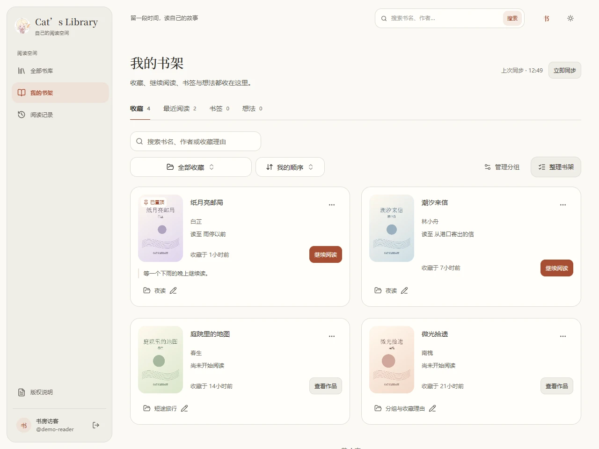
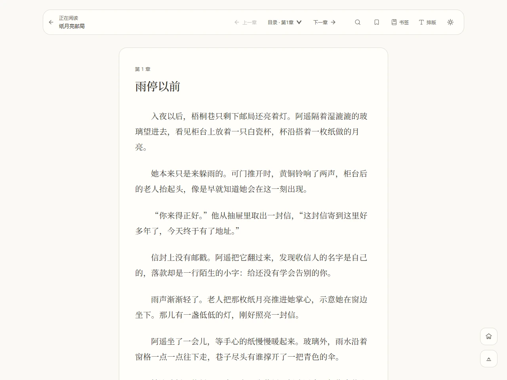

> **免责声明**　本仓库提供的代码、文档及相关功能仅供学习与技术交流。部署者应对自身部署、运营和使用本项目的行为及其后果负责，相关行为与仓库所有者无关。

# 

<div align="center">

**一间可以自己搭建的中文小说书房**

把手边的小说收进书架，在网页和 iPhone 上接着读。想写下一章时，也能带着前文和人物设定，与 AI 一起起草。

[快速开始](#快速开始) · [部署到服务器](docs/deployment.md) · [iOS 客户端](ios/README.md) · [发布与下载](https://github.com/Cinnaio/Catslibrary/releases)

</div>

## 书房里有什么

### 我的书架



**把散落的小说收成一架书。** 给收藏分组、写下喜欢它的理由，下次打开就能找到上次读到的地方。管理员可以导入 TXT、核对分章，也能为连载作品绑定已支持的书源来检查更新。

### 阅读器



**读到哪儿，就从哪儿继续。** 在阅读器里调好字体、行距和纸面颜色，遇到喜欢的一段就留个书签。用同一账号登录同一站点，换到另一台设备也能接着读。

### AI 创作

**写下一章时，翻得回前文。** 配好模型后，管理员可以围绕一本书讨论情节、查阅人物关系，或让 AI 起草续篇。草稿可以逐段读、反复改，最后由你决定是否发布。[对话创作说明](docs/ai-agent.md)

## 快速开始

本地运行需要 Git、仓库 [`.node-version`](.node-version) 指定的 Node.js，以及一个可连接的 **PostgreSQL 14 或更高版本**数据库。

```bash
git clone https://github.com/Cinnaio/Catslibrary.git
cd Catslibrary
npm ci
npm run dev
```

1. 打开[本地安装向导](http://localhost:5173/install)，填写数据库连接信息并创建首个管理员。首次连接时会自动执行数据库迁移。
2. 登录后台，在「导入与抓取」中选一本 TXT，核对书名和章节后确认入库。
3. 回到书库，打开刚导入的作品，点进第一章开始阅读。

开发时 Web 默认使用 `5173` 端口，并将 `/api` 请求转发到 `8787`。也可以通过环境变量配置服务，字段见[环境变量示例](.env.example)。

## 继续探索

| 接下来想做什么 | 从这里开始 |
| --- | --- |
| 把书房部署到自己的服务器 | [部署指南](docs/deployment.md) |
| 在 iPhone 上阅读，或为自己的站点构建客户端 | [iOS 构建与安装](ios/README.md) · [客户端内置的站点地址](ios/ZhiZhou/Networking/ServerConfig.swift) |
| 接入模型、调整追更频率、备份书库 | [功能与配置](docs/configuration.md) |
| 修改网页、API 或原生客户端 | [开发指南](docs/development.md) · [界面设计规范](DESIGN.md) |
| 查看各端的版本变化和交付情况 | [更新记录](CHANGELOG.md) · [发布记录](docs/releasing.md) |

[完整文档索引 →](docs/README.md)
